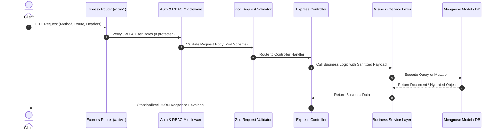
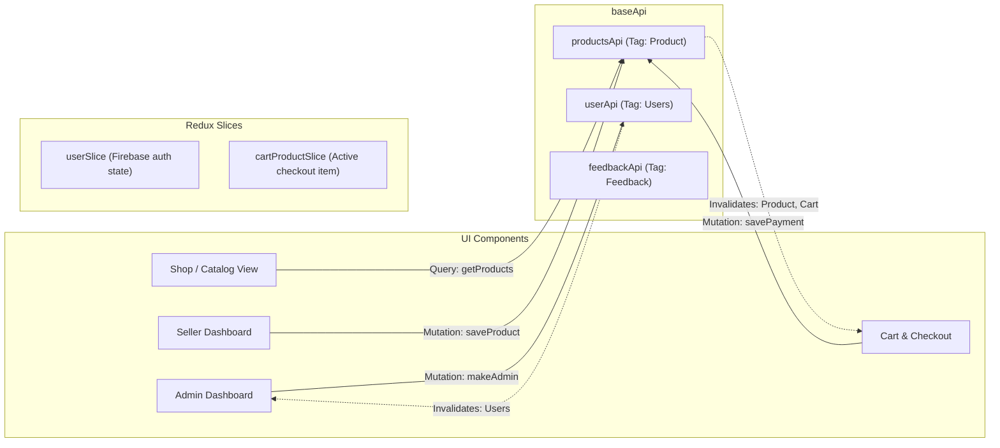
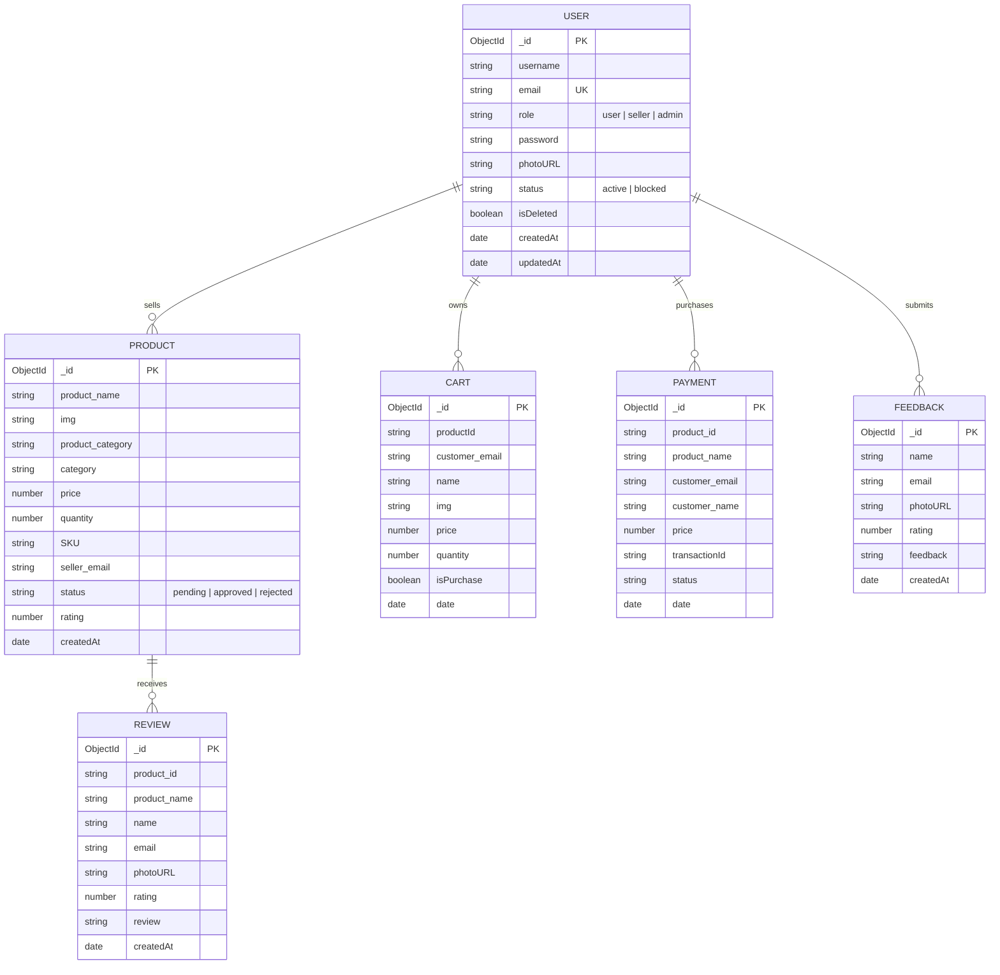

# Toy Town - System Architecture & Engineering Blueprint

This document details the architectural design, component boundaries, state management, asynchronous data flows, and database modeling for the **Toy Town** e-commerce marketplace.

---

## 1. High-Level System Architecture

Toy Town uses a decoupled client-server architecture:
- **Frontend**: Single Page Application (SPA) built with **React 18**, bundled with **Vite 6**, styled using **Tailwind CSS** and **DaisyUI**, and state-managed via **Redux Toolkit (RTK Query)**.
- **Backend**: RESTful API server powered by **Node.js** and **Express.js**, adhering to ES Modules and a domain-driven modular structure.
- **Persistence**: **MongoDB** database managed through **Mongoose 8** with fallback JSON seeding for offline resiliency.
- **Third-Party Services**:
  - **Firebase Authentication**: Client-side identity provider for Google OAuth popup and email authentication.
  - **ImgBB API**: Image hosting for seller toy uploads.
  - **Google SMTP (Nodemailer)**: Password recovery link dispatch.

```mermaid
graph TD
    Client["Client: React 18 / Vite 6 (Redux Toolkit, Tailwind, DaisyUI)"]
    Server["API Server: Node.js / Express.js (ES Modules)"]
    DB[("MongoDB Atlas (Mongoose 8)")]
    Firebase["Firebase Auth (Google OAuth & Email/Pass)"]
    ImgBB["ImgBB API (Toy Image Storage)"]
    SMTP["Google SMTP (Nodemailer Reset Service)"]

    Client -->|Social Login / Identity| Firebase
    Client -->|Image Uploads (multipart)| ImgBB
    Client -->|REST API Requests / JWT Bearer| Server
    Server -->|Mongoose ODM Queries| DB
    Server -->|Password Recovery Emails| SMTP
```

---

## 2. Layered Backend Application Architecture

The server adheres to a strict separation of concerns across request lifecycles:



---

## 3. Frontend State & RTK Query Architecture

The client manages server-side data fetching and local UI state through Redux Toolkit:



---

## 4. Database Schema Modeling

The MongoDB database is organized into six core collections:



---

## 5. High-Availability & Fallback Design

To prevent system crashes in constrained local environments or during remote database connection interruptions:
1. **Mongoose State Awareness**: The backend checks `mongoose.connection.readyState`. If the connection is down, fallback logic activates automatically.
2. **Catalog Fallback**: Product queries gracefully read from `server/data/productData.json`, ensuring the store UI remains fully browsable.
3. **In-Memory Store**: Cart, User, and Payment endpoints maintain safe in-memory collections when database connectivity is offline, preventing 500 runtime exceptions during development and demonstration.
