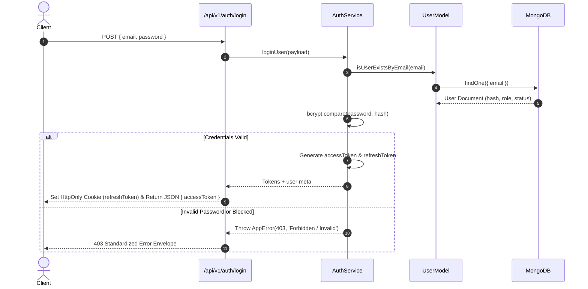

# Toy Town - Authentication & Authorization Architecture

This document specifies the authentication mechanics, token lifecycle, password security protocols, and Role-Based Access Control (RBAC) governing the **Toy Town** platform.

---

## 1. Overview & Dual-Auth Model

Toy Town integrates a hybrid authentication model:
1. **Client-Side Identity (Firebase)**: Provides instant social authentication (Google Popup) and Firebase Auth state tracking (`onAuthStateChanged`).
2. **Server-Side Security (JWT & Bcrypt)**: Issues cryptographic JWT access tokens and HttpOnly refresh token cookies, maintaining independent role-based security across all API interactions.

### Role Hierarchy
- **`admin`**: Full administrative access. Can promote/demote user roles, approve or reject seller products, remove listings, and audit system data.
- **`seller`**: Product vendor capabilities. Can add new toys (with ImgBB image uploads), modify inventory, update pricing, and delete listings.
- **`user`**: End-consumer customer. Can browse, add to cart, execute purchases, review toys, and post website feedback.

---

## 2. Authentication Flows

### A. Traditional Email & Password Flow



### B. Google Social Login & Sync Flow

1. User clicks **"Continue with Google"** on the client.
2. Firebase SDK executes `signInWithPopup(auth, GoogleAuthProvider)`.
3. Upon success, client triggers `useSaveUserMutation` targeting `PUT /api/v1/user/:email` with `userData: { name, email, photoURL }`.
4. Backend executes `UserServices.upsertUser`:
   - If user exists: updates name and photo.
   - If new user: initializes with default role `user`, status `active`, and `isDeleted: false`.

---

## 3. Token Lifecycle & Storage

| Token Type | Storage Location | Expiry | Purpose |
| :--- | :--- | :--- | :--- |
| **Access Token** | `localStorage` / RTK Query Memory Header | `30d` (Configurable) | Bearer authentication on protected API endpoints. |
| **Refresh Token** | `HttpOnly` Cookie (`refreshToken`) | `365d` (Configurable) | Automated token renewal via `POST /api/v1/auth/refresh-token`. |
| **Password Reset Token** | Signed JWT in Reset URL Query | `15m` | Single-use password update authorization. |

### Cookie Configuration Rules
In production environments (`NODE_ENV === 'production'`):
```javascript
res.cookie('refreshToken', refreshToken, {
  secure: true,
  httpOnly: true,
  sameSite: 'none',
  maxAge: 1000 * 60 * 60 * 24 * 365,
});
```
In local development environments:
- `secure: false`
- `sameSite: 'lax'`

---

## 4. Role-Based Access Control (RBAC) Middleware

Protected backend endpoints utilize the `auth(...roles)` middleware:

```javascript
import auth from '../middleware/auth.js';

// Route accessible only by Admins
router.patch('/users/admin/:id', auth('admin'), UserControllers.makeAdmin);

// Route accessible by Admins and Sellers
router.patch('/approveProduct/:id', auth('admin', 'seller'), ProductControllers.approveProduct);
```

### Security Verification Pipeline
The `auth` guard executes the following checks:
1. **Bearer Header Presence**: Verifies `Authorization` header exists and extracts token stripping the `Bearer ` prefix.
2. **Signature Verification**: Validates JWT signature with `JWT_ACCESS_SECRET`.
3. **Account Validity**:
   - Queries database to ensure user account exists.
   - Confirms `isDeleted !== true`.
   - Confirms `status !== 'blocked'`.
4. **Role Check**: If roles are specified, validates `requiredRoles.includes(user.role)`.
5. **Context Attachment**: Attaches decoded claims to `req.user`.

---

## 5. Password Reset & Recovery Workflow

1. **Request Link**: User submits email to `POST /api/v1/auth/forget-password`.
2. **Token Generation**: Server creates a signed JWT embedding `_id`, `email`, and `role` using `RESET_PASS_SECRET`.
3. **Dispatch Email**: Server dispatches an HTML email containing a direct link (`http://localhost:5173?userId=<id>&token=<token>`).
4. **Execution**: User submits new password to `POST /api/v1/auth/reset-password`:
   - Verifies token signature with `RESET_PASS_SECRET`.
   - Ensures payload target `id` matches token subject `_id` (preventing IDOR attacks).
   - Hashes password with `bcrypt` (12 rounds) and updates the user document.
